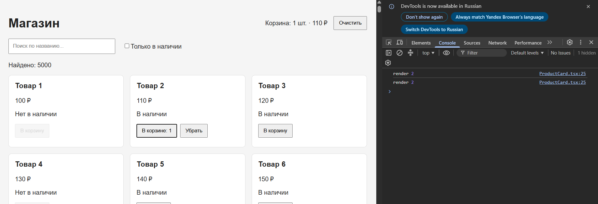

# Семинар 3. Продвинутый React и управление состоянием

## Описание проекта

Интернет-магазин на React 18+ и TypeScript, созданный с помощью Vite. Каталог содержит 5000 товаров.

В проекте реализованы поиск, фильтрация по наличию, корзина и оптимизация перерисовок компонентов.

## Запуск проекта

Установить зависимости:

```bash
npm install
```

Запустить сервер разработки:

```bash
npm run dev
```

Открыть адрес, который покажет Vite (обычно http://localhost:5173/).

## Шаг 1. Каталог и фильтрация

- Создан массив из 5000 товаров.
- Реализован поиск по названию без учёта регистра и пробелов по краям.
- Добавлен фильтр «Только в наличии».
- Отображается количество найденных товаров.
- Поле поиска автоматически получает фокус при загрузке страницы.

Использованы `useState`, `useMemo`, `useRef`, `useEffect`.

## Шаг 2. Корзина через useReducer

Реализованы три действия:

- `add` — добавляет товар или увеличивает его количество.
- `remove` — полностью удаляет товар из корзины.
- `clear` — очищает корзину.

В шапке отображаются общее количество товаров и итоговая стоимость. Для товаров, отсутствующих в наличии, кнопка добавления отключена.

## Шаг 3. Оптимизация перерисовок

Для оптимизации используются:

- `React.memo` — предотвращает повторную отрисовку карточек, пропсы которых не изменились.
- `useCallback` — сохраняет стабильные ссылки на обработчики добавления, удаления и очистки корзины.
- `useMemo` — запоминает результаты фильтрации, подсчёта итогов и формирования `qtyById`.

### Зачем нужен useCallback?

Без `useCallback` при каждом обновлении `App` создаются новые функции `handleAdd` и `handleRemove`. Из-за этого `React.memo` может считать пропсы карточек изменившимися и повторно отрисовывать их.

`useCallback` сохраняет ссылки на функции между рендерами. Благодаря этому при добавлении товара изменяется только `qty` соответствующей карточки, а остальные карточки не требуют повторной отрисовки.

### Проверка оптимизации

После очистки консоли браузера был добавлен товар №2.

В консоли появились только сообщения:

```text
render 2
render 2
```

Двойной вызов связан с `React.StrictMode` в режиме разработки. Сообщений о рендере остальных карточек не было.

### Скриншот проверки



## История коммитов

- `step-1` — каталог, поиск и фильтрация.
- `step-2` — корзина через `useReducer`.
- `step-3` — оптимизация через `React.memo`, `useCallback`, `useMemo`.